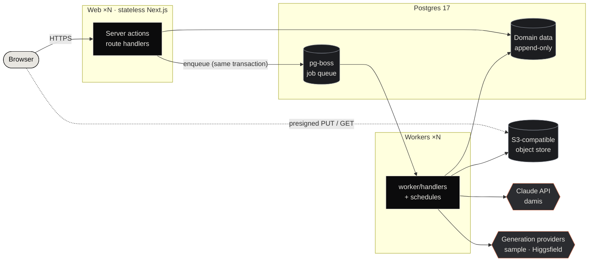

<div align="center">


<h1>B L A X Z Y</h1>

<p><b>Four steps. One film.</b><br />
<sub>A self-hosted AI film-generation platform: from a script to every clip of the production, organised and ready for an editor.</sub></p>

<p>
<a href="https://github.com/Parsa-Mansouri/BLAXZY/actions/workflows/ci.yml"></a>


=22.2" src="https://img.shields.io/badge/Node-%E2%89%A522.2-000000?style=flat-square&logo=nodedotjs&logoColor=5FA04E" />


</p>

<p>
<a href="#what-it-does"><b>What it does</b></a> ·
<a href="#quickstart"><b>Quickstart</b></a> ·
<a href="#architecture"><b>Architecture</b></a> ·
<a href="#configuration"><b>Configuration</b></a> ·
<a href="#operations"><b>Operations</b></a> ·
<a href="#reference"><b>Reference</b></a>
</p>

</div>

---

## What it does

BLAXZY is a self-hosted AI film-generation platform: a Next.js web app and background workers,
Postgres, S3-compatible storage, the Claude API for every text and reasoning step, and a generation
provider layer for images and video. A user describes or uploads a script and the Wizard takes them,
stage by stage, to a full set of generated clips.


| Stage              | What happens                                                                                                                  | Produces                                                          |
| ------------------ | ----------------------------------------------------------------------------------------------------------------------------- | ----------------------------------------------------------------- |
| **Style**          | Style, genre, movie or series, duration, portrait or landscape                                                                | `Output_01`: the answers that tailor the script dami              |
| **Script**         | Upload a script for a dami to check, or describe it and a dami writes it; review until accepted                               | `Output_021` detected assets, `Output_022` directed prompt blocks |
| **Pre-production** | Upload or generate an image per asset, review it; the sheet generator dami builds its sheet                                   | `Output_030`: the approved sheets                                 |
| **Production**     | Sheets bound to blocks, credits confirmed, drafts and finals generated, every clip checked by a dami and reviewed by the user | `Output_04`: every clip, packed into one ZIP on export            |

The full product brief lives in [`docs/PROJECT_BRIEF.md`](docs/PROJECT_BRIEF.md).

---

## Quickstart

Requirements: **Node >= 22.2**, **pnpm 9**, **Docker**.

```bash
pnpm install
cp .env.example .env          # adjust values / host ports if needed
docker compose up -d          # Postgres 17 + S3 store, creates bucket "blaxzy"
pnpm db:migrate               # apply migrations
pnpm dev                      # web at http://localhost:3000
pnpm worker:dev               # background worker (separate terminal)
```

Default host ports (override in `.env`): Postgres `5432`, S3 API `9100`, S3 console `9101`.
The S3 store is RustFS (the official MinIO images are no longer published); console login is `blaxzy` / `blaxzy-secret`.

> [!TIP]
> Out of the box every dami and every generation runs in **sample mode** (`DAMI_MODE=sample`,
> `GENERATION_PROVIDER=sample`): no Claude key, no provider account and no cost. Create an account
> with `pnpm dev:user` and the whole flow runs locally.

### Commands

| Command                                                                                                                     | What it does                                                                             |
| --------------------------------------------------------------------------------------------------------------------------- | ---------------------------------------------------------------------------------------- |
| `docker compose up -d`                                                                                                      | Start Postgres + S3 store (bucket `blaxzy`); `cp .env.example .env` first                |
| `pnpm dev`                                                                                                                  | Web on :3000                                                                             |
| `pnpm worker` / `pnpm worker:dev`                                                                                           | Background worker                                                                        |
| `pnpm build` / `pnpm start`                                                                                                 | Build and start the web app                                                              |
| `pnpm worker:build`                                                                                                         | Bundle the worker to `dist/worker.cjs`                                                   |
| `pnpm migrate:build`                                                                                                        | Bundle the migrator to `dist/migrate.cjs`                                                |
| `pnpm typecheck`, `pnpm lint`, `pnpm format` / `format:check`, `pnpm test`                                                  | Individual checks                                                                        |
| `pnpm check`                                                                                                                | Typecheck, lint, format:check and test                                                   |
| `pnpm db:generate` / `db:migrate` / `db:studio`                                                                             | drizzle-kit (reads `.env`)                                                               |
| `pnpm db:migrate:prod`                                                                                                      | Apply the migrations with drizzle-orm's migrator (what the Docker `migrate` target runs) |
| `pnpm dev:user`, `dev:credits`, `dev:script-flow`, `dev:preprod-flow`, `dev:generation`, `dev:production-flow`, `dev:sweep` | Dev scripts in `scripts/` (see [Development scripts](#development-scripts))              |
| `pnpm dami:run <key> <input.json> [--live]`                                                                                 | Run one dami by hand; paid calls need `--live`                                           |
| `pnpm hf:seedance`                                                                                                          | One billable Higgsfield Seedance 2.5 test; reads `HF_CREDENTIALS` from `.env.local`      |

---

## Architecture



**Engineering rules** (the full list is in [`CLAUDE.md`](CLAUDE.md)):

- **Stateless web.** No in-memory state shared between requests; files live in object storage. Run
  as many web and worker processes as needed.
- **Jobs, not request handlers.** Long-running work is enqueued (`src/server/jobs`) and done by a worker.
- **Append-only data.** Domain records are versioned; never overwritten or hard-deleted.
- **Paginated and indexed.** Every list query is paginated; every table has indexes for its access paths.
- **Thin routes.** `src/app` and `src/ui` call `src/server/<module>` services, never the database or the
  Claude API directly (ESLint enforces the import boundaries).

| Stack      |                                                                              |
| ---------- | ---------------------------------------------------------------------------- |
| Web        | Next.js 16, React 19, TypeScript strict                                      |
| Data       | Postgres 17, drizzle-orm, migrations in `drizzle/` (tracked)                 |
| Queue      | pg-boss on the same Postgres (`JOBS_SCHEMA`)                                 |
| Storage    | S3-compatible (RustFS locally; AWS S3 and RustFS support conditional writes) |
| Reasoning  | Claude API (`@anthropic-ai/sdk`), every process a dami                       |
| Generation | Provider layer: `sample` (local PNG and MP4 via ffmpeg); Higgsfield SDK      |
| Accounts   | better-auth (email + password)                                               |

---

## Configuration

All configuration is read from the environment (see `.env.example` and `src/server/env.ts`).

> [!WARNING]
> In production (`NODE_ENV=production`) the app refuses to start with: a `BETTER_AUTH_SECRET` shorter than 32
> characters or equal to the example value, a `BETTER_AUTH_URL` that is unset or not `https://`, or
> `EMAIL_TRANSPORT=console`. With `EMAIL_TRANSPORT=smtp` (any environment) `SMTP_HOST`, `SMTP_PORT` and a valid
> `EMAIL_FROM` are required. `DAMI_MODE` and `GENERATION_PROVIDER` keep their `sample` defaults in production on
> purpose until real providers are switched on.

<details>
<summary><b>Environment variables</b> (all of them, with defaults)</summary>

<br />

| Variable                          | Default                          | Notes                                                                                                                                                                                                                    |
| --------------------------------- | -------------------------------- | ------------------------------------------------------------------------------------------------------------------------------------------------------------------------------------------------------------------------ |
| `NODE_ENV`                        | `development`                    | `development`, `test` or `production`. `production` turns on the extra checks listed above                                                                                                                               |
| `DATABASE_URL`                    | (required)                       | Postgres connection string                                                                                                                                                                                               |
| `DATABASE_POOL_MAX`               | `10`                             | Connections in each process's own pool (web and worker); see the connection budget below                                                                                                                                 |
| `BETTER_AUTH_SECRET`              | (required)                       | Signs cookies and tokens; at least 32 characters (`openssl rand -base64 32`). In production it must not be the `.env.example` value                                                                                      |
| `BETTER_AUTH_URL`                 | `http://localhost:3000`          | Public origin of the app; the only trusted origin. In production it must be set explicitly and be `https://`                                                                                                             |
| `AUTH_TRUSTED_PROXIES`            | empty                            | Comma-separated IPs/CIDRs of reverse proxies whose forwarded client address auth rate limiting trusts; see Reverse proxy and client IP                                                                                   |
| `AUTH_IP_HEADER`                  | unset                            | Header your proxy always overwrites with the client address (e.g. `x-real-ip`); lower-cased; see Reverse proxy and client IP                                                                                             |
| `EMAIL_TRANSPORT`                 | `console`                        | `console` prints emails and their links to the server log (development only; refused in production); `smtp` sends them                                                                                                   |
| `EMAIL_FROM`                      | `BLAXZY <no-reply@blaxzy.local>` | Sender address (one address, no line breaks; checked when `EMAIL_TRANSPORT=smtp`)                                                                                                                                        |
| `SMTP_HOST`                       | unset                            | SMTP server; required when `EMAIL_TRANSPORT=smtp`                                                                                                                                                                        |
| `SMTP_PORT`                       | unset                            | SMTP port (587 for STARTTLS, 465 for implicit TLS); required when `EMAIL_TRANSPORT=smtp`                                                                                                                                 |
| `SMTP_USER`                       | unset                            | SMTP login (used only together with `SMTP_PASSWORD`)                                                                                                                                                                     |
| `SMTP_PASSWORD`                   | unset                            | SMTP password                                                                                                                                                                                                            |
| `SMTP_SECURE`                     | unset                            | `true`: TLS from the first byte (port 465). `false`/unset: STARTTLS is mandatory and a server without it is refused (only a loopback host in development may stay plain, for a local mail catcher)                       |
| `S3_ENDPOINT`                     | (required)                       | Object storage endpoint the server talks to                                                                                                                                                                              |
| `S3_REGION`                       | `us-east-1`                      | Object storage region                                                                                                                                                                                                    |
| `S3_BUCKET`                       | (required)                       | Bucket name                                                                                                                                                                                                              |
| `S3_ACCESS_KEY_ID`                | (required)                       | Object storage access key                                                                                                                                                                                                |
| `S3_SECRET_ACCESS_KEY`            | (required)                       | Object storage secret key                                                                                                                                                                                                |
| `S3_FORCE_PATH_STYLE`             | `true`                           | Path-style addressing (needed by most self-hosted S3 stores)                                                                                                                                                             |
| `S3_PUBLIC_ENDPOINT`              | `S3_ENDPOINT`                    | Origin browsers use in presigned upload/download URLs (only for presigning). It is also baked into the Content-Security-Policy at `next build` time: set it when building (Docker: `--build-arg S3_PUBLIC_ENDPOINT=...`) |
| `S3_CORS_ORIGINS`                 | `http://localhost:3000`          | Compose only: origins `minio-init` allows to PUT/GET the bucket (comma-separated)                                                                                                                                        |
| `POSTGRES_PORT`                   | `5432`                           | Compose only: host port of Postgres (bound to 127.0.0.1)                                                                                                                                                                 |
| `MINIO_API_PORT`                  | `9100`                           | Compose only: host port of the S3 API (bound to 127.0.0.1)                                                                                                                                                               |
| `MINIO_CONSOLE_PORT`              | `9101`                           | Compose only: host port of the S3 console (bound to 127.0.0.1)                                                                                                                                                           |
| `JOBS_SCHEMA`                     | `pgboss`                         | Postgres schema of the job queue (pg-boss, same `DATABASE_URL`)                                                                                                                                                          |
| `JOBS_WEB_POOL_MAX`               | `2`                              | Queue connection pool per web process                                                                                                                                                                                    |
| `JOBS_WORKER_POOL_MAX`            | `10`                             | Queue connection pool per worker process                                                                                                                                                                                 |
| `WORKER_CONCURRENCY_DEFAULT`      | `2`                              | Jobs of one type a worker process runs at once                                                                                                                                                                           |
| `WORKER_CONCURRENCY`              | empty                            | Per job type overrides, e.g. `script.generate=4,video.render=0` (`0` = not on this worker)                                                                                                                               |
| `WORKER_POLL_INTERVAL_SECONDS`    | `2`                              | How often an idle worker checks for jobs                                                                                                                                                                                 |
| `WORKER_SHUTDOWN_TIMEOUT_SECONDS` | `25`                             | Wait for in-flight jobs on SIGTERM; keep the container stop grace period longer                                                                                                                                          |
| `ANTHROPIC_API_KEY`               | unset                            | Claude API; without it damis run in sample mode                                                                                                                                                                          |
| `ANTHROPIC_WORKSPACE_ID`          | unset                            | Only for an API key that is not scoped to a workspace: the workspace to bill (sent as `anthropic-workspace-id`)                                                                                                          |
| `DAMI_MODE`                       | `sample`                         | `sample` returns generated sample output (testing-phase default); `live` calls Claude; `auto` = `sample` without an API key                                                                                              |
| `DAMI_SAMPLE_DELAY_MS`            | `3000`                           | Artificial latency of one sample-mode dami call (`0` in tests)                                                                                                                                                           |
| `DAMI_DEFAULT_MODEL`              | unset                            | Overrides every dami's default Claude model (unset = per-dami defaults)                                                                                                                                                  |
| `DAMI_MAX_CONCURRENCY`            | `4`                              | Per-process limit on concurrent Claude calls made by damis; see Claude concurrency below                                                                                                                                 |
| `DAMI_MAX_RETRIES`                | `4`                              | Retries per Claude call for rate limits, overloads and network errors                                                                                                                                                    |
| `GENERATION_PROVIDER`             | `sample`                         | `sample` renders placeholder images and MP4 clips locally (no cost); `higgsfield` is not wired yet                                                                                                                       |
| `HF_CREDENTIALS`                  | unset                            | Higgsfield API key `KEY_ID:KEY_SECRET`, server-side only; keep it in `.env.local` (git-ignored). `pnpm hf:seedance` runs one billable Seedance 2.5 test                                                                  |
| `GENERATION_SAMPLE_DELAY_MS`      | `3000`                           | How long one sample generation takes (`0` in tests)                                                                                                                                                                      |
| `GENERATION_MAX_PER_USER`         | `3`                              | Generations one user may have running at once; extra jobs are rescheduled, not failed                                                                                                                                    |
| `GENERATION_STUCK_AFTER_MINUTES`  | `120`                            | `generation.sweep` (every 5 min) fails and refunds generations queued or running longer than this                                                                                                                        |
| `FFMPEG_PATH`                     | unset                            | ffmpeg used for sample video; unset = the `ffmpeg-static` package (dev dependency), else `ffmpeg` on the PATH                                                                                                            |

</details>

<details>
<summary><b>Database connection budget</b></summary>

<br />

Every process opens its own pools. Per web process: `DATABASE_POOL_MAX` + `JOBS_WEB_POOL_MAX` (default 10 + 2).
Per worker process: `DATABASE_POOL_MAX` + `JOBS_WORKER_POOL_MAX` (default 10 + 10). The sum over all web
and worker processes must stay below Postgres `max_connections` (default 100, minus what migrations,
admin tools and monitoring use). With many replicas, lower the pool sizes or put a pooler (PgBouncer in
transaction mode, or your provider's pooler) between the processes and Postgres.

</details>

<details>
<summary><b>Claude concurrency</b></summary>

<br />

`DAMI_MAX_CONCURRENCY` limits concurrent Claude calls **per process**. The total is the number of
processes that run damis (workers) times this value: 3 workers at 4 allow up to 12 calls at once, so size it
against your Claude API rate limits.

</details>

<details>
<summary><b>Reverse proxy and client IP</b></summary>

<br />

Auth endpoints are rate limited per client IP, so the app has to know the real client address. Behind a
reverse proxy or load balancer set one of:

- `AUTH_TRUSTED_PROXIES`: the proxy's IPs/CIDRs (e.g. `10.0.0.0/8`); the forwarded address is believed only
  when the request really comes from one of them;
- `AUTH_IP_HEADER`: a header your proxy always overwrites with the client address (e.g. `x-real-ip`);
  the proxy must drop any value the client sends.

With neither, the rate limiter cannot identify clients reliably (all clients may share one bucket, or a
client may forge its address).

</details>

---

## Operations

### Production image

One Dockerfile, two images: the web image (default target) and the worker image, which adds
sharp, fonts and ffmpeg (for sample video; `FFMPEG_PATH` is set in the image):

```bash
docker build -t blaxzy .                                  # web
docker build --target worker -t blaxzy-worker .           # worker
docker run --env-file .env -p 3000:3000 blaxzy
docker run --env-file .env --stop-timeout 30 blaxzy-worker
```

> [!IMPORTANT]
> The web build bakes the Content-Security-Policy in, so pass the S3 browser origin when building:
> `docker build --build-arg S3_PUBLIC_ENDPOINT=https://s3.example.com -t blaxzy .` (see the environment table).

Locally, sample video uses the `ffmpeg-static` package (a dev dependency), or
`ffmpeg` on the PATH (`FFMPEG_PATH` overrides both).

The worker drains in-flight jobs on SIGTERM for up to `WORKER_SHUTDOWN_TIMEOUT_SECONDS`; give the
container a longer stop timeout (Docker's default is 10 s).

<details>
<summary><b>Migrations in production</b></summary>

<br />

The images contain no drizzle-kit. A third image target, `migrate`, bundles drizzle-orm's migrator and the
tracked `drizzle/` folder; run it once per deploy, before starting the new web and worker containers:

```bash
docker build --target migrate -t blaxzy-migrate .
docker run --rm -e DATABASE_URL=postgresql://... blaxzy-migrate
```

It needs only `DATABASE_URL`, logs what it applies, exits 0 when the database is up to date and 1 on failure.
A Postgres advisory lock makes two concurrent runs queue instead of racing. It writes the same journal
(`drizzle.__drizzle_migrations`) as `pnpm db:migrate`, so a database migrated in development is not migrated
twice. From a checkout: `pnpm db:migrate:prod`.

</details>

<details>
<summary><b>Health endpoint</b></summary>

<br />

`GET /api/health` needs no session and is never cached. It answers `200 {"status":"ok"}` when `select 1`
succeeds within 2 seconds and `503 {"status":"unavailable"}` otherwise, with no version or error details.
The web image has a Docker `HEALTHCHECK` on it; use it as the readiness probe of your orchestrator. The worker
serves no port and has no heartbeat, so its image has no health check; rely on a restart policy.

</details>

<details>
<summary><b>Security headers</b></summary>

<br />

Every response carries `X-Content-Type-Options: nosniff`, `X-Frame-Options: DENY`, a
`Referrer-Policy`, a `Permissions-Policy`, a Content-Security-Policy and, in production builds,
`Strict-Transport-Security`. The policy (`next.config.ts`) is static, with no nonces: it allows inline
scripts and styles (`'unsafe-inline'`, which Next's bootstrap scripts and React `style` attributes
need) and closes everything else (`default-src 'self'`, `object-src 'none'`, `frame-ancestors 'none'`,
`form-action 'self'`). Images, media and connections are allowed from `'self'` and from the S3 origin.
That origin is fixed **at `next build` time** from `S3_PUBLIC_ENDPOINT` (else `S3_ENDPOINT`): build with
`--build-arg S3_PUBLIC_ENDPOINT=https://s3.example.com`. If neither is set in a production build the
policy falls back to any `https:` origin for images, media and connections, which works but is
looser. Changing the S3 origin later means rebuilding the web image.

</details>

### Background jobs

Long work runs in workers through the typed job queue in `src/server/jobs` (pg-boss on Postgres):
web code calls `enqueue(job, payload)`, handlers live in `worker/handlers/`. Run as many web and
worker processes as needed; see `src/server/jobs/README.md` for concurrency and the idempotency
rule every handler must follow.

A job that exists because of a row is sent on the transaction that writes the row, so the job exists
exactly when the row does. If the send fails the request fails (the user sees "could not start, try
again") and nothing is left half-written. A request that touches many rows sends one
`production.dispatch` job (`prepare` or `takes`) and the worker fans it out into one job per row.

<details>
<summary><b>Schedules</b> (registered by every worker)</summary>

<br />

Every worker registers these schedules (UTC; pg-boss keeps one schedule per job and sends each
occurrence once, however many workers run):

| Job                | Schedule         | What it does                                                                                                                                                                                                                               |
| ------------------ | ---------------- | ------------------------------------------------------------------------------------------------------------------------------------------------------------------------------------------------------------------------------------------ |
| `generation.sweep` | every 5 minutes  | Fails and refunds generations running longer than `GENERATION_STUCK_AFTER_MINUTES` or queued and never started for 12 hours; re-sends lost run jobs; re-runs completion hooks that did not finish. `pnpm dev:sweep` runs one sweep by hand |
| `dami.sweep`       | every 15 minutes | Marks dami runs still `running` after 90 minutes (their process died) as `aborted`                                                                                                                                                         |
| `file.sweep`       | every 15 minutes | Marks uploads still `pending` after 6 hours as `abandoned` and deletes their objects                                                                                                                                                       |
| `ratelimit.prune`  | every 5 minutes  | Deletes rate-limit windows older than 10 minutes                                                                                                                                                                                           |

</details>

### Rate limits

Server actions, polls and file reads are limited per user in fixed 60-second windows. The counters
are in the `action_rate_limit` table, shared by all replicas (`ratelimit.prune` cleans it up). Over the
limit the request is refused with a retry-after time. If the counter cannot be read, the buckets that
start paid work refuse the request and the others allow it (and log).

<details>
<summary><b>Rate-limit buckets</b></summary>

<br />

| Bucket      | Per minute | Used for                                                                              | If the counter fails |
| ----------- | ---------- | ------------------------------------------------------------------------------------- | -------------------- |
| `mutate`    | 60         | Ordinary writes: rename, review decisions that start nothing                          | allow                |
| `upload`    | 30         | Upload tickets                                                                        | refuse               |
| `expensive` | 20         | Anything that enqueues model or generation work or spends credits                     | refuse               |
| `poll`      | 600        | Background polls                                                                      | allow                |
| `read`      | 240        | Pagination loads and one-off reads                                                    | allow                |
| `file`      | 1200       | `/api/files/[id]` (every stored picture on a screen is one request)                   | allow                |
| `otp`       | 5          | Code guesses: email verification (per address, any IP) and password change (per user) | refuse               |
| `codeSend`  | 3          | Emails a signed-in user asks for (the password change code)                           | refuse               |

The limits are constants in `src/server/ratelimit/buckets.ts`. Auth endpoints have their own per-IP
limit (see Accounts).

</details>

---

## Reference

### Damis

Damis are the Claude-powered processes (`src/server/damis`, see its README). To run one by hand
(the run is recorded in `dami_run`):

```bash
pnpm dami:run script-writer src/server/damis/script-writer/fixtures/input.json [--project <id>] [--live]
```

> [!WARNING]
> With `DAMI_MODE=live` (or `auto` and an `ANTHROPIC_API_KEY` set) this makes **paid** Claude calls, and
> `dami:run` refuses to start them unless `--live` is given.

By default (`DAMI_MODE=sample`, the testing-phase setting) every dami answers in **sample mode**: output is
generated from the actual input by small deterministic generators (`src/server/damis/sample/`),
stored in `dami_run` with model `sample` and no cost, and script versions show `isSample`. The
whole Script stage then runs end to end locally:

```bash
pnpm worker            # in one terminal
pnpm dev:script-flow   # creates a project for testuser@gmail.com and runs brief → review → detection → directed blocks
```

### Generation and credits

Images (and later video) are made through the provider layer (`src/server/providers`), paid with
credits (`src/server/billing`) and run by the `generation.run` job (`src/server/generation`; see
their READMEs). By default the **sample provider** renders placeholder PNGs and MP4 clips (ffmpeg) locally:

```bash
pnpm dev:credits testuser@gmail.com 100   # grant credits (development only)
pnpm worker                               # in one terminal
pnpm dev:generation                       # a look, a sheet, a draft clip and its final on the latest project
pnpm dev:sweep                            # fail + refund generations stuck past GENERATION_STUCK_AFTER_MINUTES
pnpm dev:preprod-flow                     # a character (look, sheet), a location pack and a prop sheet on "The Lighthouse Keeper"
pnpm dev:production-flow [email] [title]  # drafts and finals on a project in production (default "QA Run 14:03")
```

> [!NOTE]
> `GENERATION_PROVIDER=higgsfield` is not wired yet. `pnpm hf:seedance` makes one **billable**
> Higgsfield Seedance 2.5 call with `HF_CREDENTIALS` from `.env.local` (git-ignored).

### Uploads and storage

Files go straight from the browser to the S3 store through presigned URLs
(`src/server/storage`, see its README). The bucket needs CORS for the app origins; locally
`minio-init` applies it (`docker compose up --no-deps minio-init` after changing
`S3_CORS_ORIGINS`).

- **Write-once.** An upload URL is signed with `If-None-Match: *`, so the store refuses a second PUT
  to the same key. The store must implement conditional writes (AWS S3 and RustFS do). A store that
  ignores the header lets a user replace a file after it was confirmed for as long as the upload
  link is valid (15 minutes); nothing else prevents that.
- **Content check.** On confirm the server compares size and type with what was declared and checks
  the first bytes against the declared type's signature; a mismatching object is deleted.
- **Unfinished uploads.** A user may hold at most 50 unconfirmed upload tickets; `file.sweep` retires
  the ones nobody finished (the row is kept, as `abandoned`).
- **Large files.** Streams above 64 MiB that a worker writes (export ZIPs) are uploaded in parts, so
  memory stays flat.
- **Downloads.** Download links last 5 minutes. Images (not SVG), video and audio display inline;
  every other type is forced to download.

### Exports

A project's finished clips are packed into one ZIP by the `export.build` job, streamed from and to
the object store. The ZIP uses ZIP64 where a size or offset needs it. The limit is 20 GB per ZIP; a
larger film is refused with a message telling the user to download the clips one by one.

### Accounts

better-auth (email + password) is served at `/api/auth/*`. Sign-up is open; the email must be
verified before signing in, with a six-digit code sent by email (valid 10 minutes). In development
the verification codes and password-reset links appear in the `pnpm dev` log (console transport);
production sends them over SMTP. Auth endpoints are rate
limited per client IP (better-auth's defaults, for example 3 per 10 s for sign-in, sign-up and
password change), with counters in the `rate_limit` table so all web replicas share them. Behind a
reverse proxy, make sure it sets `X-Forwarded-For` to the single client address and configure
`AUTH_TRUSTED_PROXIES` or `AUTH_IP_HEADER` (see [Reverse proxy and client IP](#configuration)).

### Tests and checks

`pnpm check` runs typecheck, lint, format check and the tests; CI (`.github/workflows/ci.yml`) adds the
builds and a dependency audit. `pnpm test` is vitest. The integration tests (the files named
`*.integration.test.ts`) need three things: Postgres with the migrations applied, the S3 bucket and
ffmpeg (for the video tests). A global setup probes them once:

- By default a missing service skips the integration tests and prints one summary line saying what
  is missing.
- `CI` set to any non-empty value (most CI systems do) or `REQUIRE_INTEGRATION=1`: a missing service
  fails the whole run instead.
- `SKIP_INTEGRATION=1`: skip the integration tests on purpose.
- `TEST_DATABASE_URL`: run against a separate database instead of `DATABASE_URL` (apply the migrations
  to it first: `DATABASE_URL=... pnpm db:migrate`).
- The tests write to and hard-delete from the database, so the run is refused unless the database
  and `S3_ENDPOINT` are on a local host (`localhost`, loopback, the compose service names `postgres` and
  `minio`, `host.docker.internal`). `ALLOW_REMOTE_TEST_DB=1` overrides the check; never point it at a
  database you care about.

Damis and generations use their sample modes in tests (`DAMI_MODE=sample`, `GENERATION_PROVIDER=sample`,
no delays), so no Claude key is needed.

### Development scripts

> [!CAUTION]
> The scripts in `scripts/` (`dev:*`, `dami:run`) write to the database. They refuse to run with
> `NODE_ENV=production`, or when `DATABASE_URL` or `S3_ENDPOINT` points at a non-local host, unless
> `ALLOW_DEV_SCRIPTS=1` is set (the script then prints a warning). They read `.env`.

```bash
pnpm dev:user you@example.com "Your Name" [--update-existing]   # a verified admin account
```

The password comes from `DEV_USER_PASSWORD`, else a hidden prompt (or the first line of stdin); it is
never a command-line argument. An existing account with that email is left alone unless
`--update-existing` is given (it then becomes a verified admin with the new password). The script
skips email verification and the password length rule.

---

<div align="center">

<sub>
Commands, folder map and engineering rules: <a href="CLAUDE.md"><code>CLAUDE.md</code></a> ·
Specs and contracts: <a href="docs/"><code>docs/</code></a> ·
Product brief: <a href="docs/PROJECT_BRIEF.md"><code>docs/PROJECT_BRIEF.md</code></a>
</sub>

<br /><br />

<b>BLAXZY</b>

</div>
